# FIDScript User Flow Guide

> **The definitive guide to how a person moves through FIDScript: what they see first, what each level means, which application powers which screen, and what the menu shows at every step.**
>
> Audience: product, design and engineering. Companion to `docs/USER_FLOW_SYSTEM.md` (the audit of what is wrong today). This document is the **prescription**.

---

## 0. The principle in one paragraph

FIDScript is a **control plane**. It does not re-implement databases, storage, realtime, mail, metrics or package registries. It **installs best-in-class applications once, wraps each in a consistent FIDScript experience (or links straight to the app's own UI when that UI is already correct), and lets every project switch on only what it needs.**

> **Instant owns the application's tables, users, permissions and files. The platform owns where the application runs.**

Three rules govern every screen:

1. **A screen belongs to exactly one level** (Platform, Project, Application).
2. **A menu is derived from what the thing really has**, never a fixed list of fifteen.
3. **A one-time thing never sits in a permanent menu.**

### The whole system in one picture

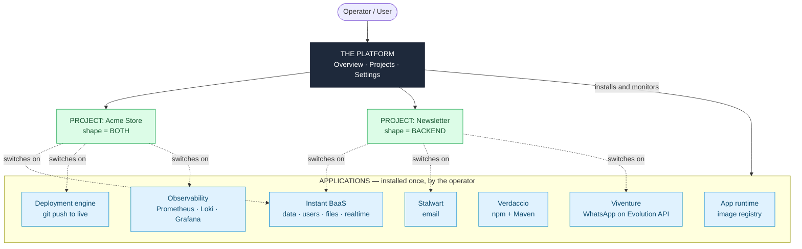

**Read it top to bottom:** the platform installs applications once; projects choose which of those applications they use.

### Where this lands in this repository

| In the guide | Here |
|---|---|
| The seven applications | `installer/addons/{instant,whatsapp,package-manager,observability,app-runtime}/` — plus the two always-on ones: the deployment engine (`apps/api/src/modules/deployments/`) and email (Stalwart, `apps/api/src/modules/email/stalwart/`). The catalogue is `apps/api/src/modules/applications/applications.catalog.ts`. |
| **Viventure / Evolution API** | The WhatsApp application is `installer/addons/whatsapp/` — the Evolution API, its database, its cache and its console. (`apps/whatsapp-api/` in this repository is the **Viventure** app itself, and it is deliberately **excluded** from the pnpm workspace — it has its own lockfile and its own CI.) |
| The platform's top bar | `apps/dashboard/src/navigation/platform-nav.ts` (five items today). |
| The project's sidebar | `apps/dashboard/src/app/(app)/projects/[projectId]/nav-groups.ts` (two fixed sets today, chosen by a `localStorage` toggle). |
| The Instant seam | `apps/api/src/modules/instant/` — provisioning, the encrypted admin token, and the config handed to a deployed app. |
| The route inventory | `apps/dashboard/src/navigation/route-inventory.ts`, with `route-inventory.test.ts` checking it against the route tree on disk. |
| The overlap decisions this guide follows | `docs/CAPABILITY_OVERLAP.md` — the audit that already ruled "keep" and "delegate" for every capability. |

---

## 1. Vocabulary (use these words, and only these words)

| Word | Means | Never call it |
|---|---|---|
| **Platform** | The installed FIDScript system and its operator's account | "Dashboard", "Console" (ambiguous) |
| **Application** | An external product the operator installs once (Instant, Viventure/Evolution, Stalwart, Verdaccio, Observability, App runtime, Deployment engine) | "Feature", "Service" |
| **Project** | One workspace: members, settings, and the capabilities switched on for it | "App", "Environment" |
| **Capability** | Something a project has switched on (Backend, Deployments, Email, WhatsApp, Packages, Observability) | "Module", "Service" |
| **Deployment** | A running, built application inside a project (one repo, one runtime) | **"Service"**: retire this word entirely |
| **Backend** | The project's InstantDB app (data, auth, files, realtime) | "Database" (reserved for managed Postgres) |

**Retire:** "Services" (merged into Deployments), the Deploy/Backend `localStorage` toggle, and any screen titled just "Settings" without saying whose.

---

## 2. The three levels

| Level | Belongs to | Lives in | Answers the question |
|---|---|---|---|
| **Platform** | The operator | Top bar | "What is installed and who am I?" |
| **Project** | Project owner + members | Project sidebar | "What does this project do and have?" |
| **Application** | The operator, once | First-time setup, then Settings → Applications | "Is the tooling this platform relies on healthy?" |

```
┌──────────────────────────── THE PLATFORM (top bar) ────────────────────────────┐
│  Overview      Projects      Settings                          [account menu]  │
│                                                                                │
│  ┌──────────── APPLICATIONS (set up once, then live in Settings) ───────────┐  │
│  │ Instant · Deployments · Email · WhatsApp · Packages · Observability      │  │
│  └──────────────────────────────────────────────────────────────────────────┘  │
│                                                                                │
│  ┌── PROJECT: Acme Store ──────────────┐   ┌── PROJECT: Newsletter ─────────┐  │
│  │ sidebar derived from its shape      │   │ sidebar derived from its shape │  │
│  │  Overview  Members  Activity        │   │  Overview  Members  Activity   │  │
│  │  Backend   Deployments  Domains     │   │  Backend   Email  WhatsApp     │  │
│  │  Monitoring  Logs  Settings         │   │  Monitoring  Logs  Settings    │  │
│  └─────────────────────────────────────┘   └────────────────────────────────┘  │
└────────────────────────────────────────────────────────────────────────────────┘
```

---

## 3. The applications and how each one is presented

The operator installs these once. For each, the decision is **Link out**, **Wrap**, or **Both**. The test: *does the application already have a correct UI for this job?*

| Application | Powers | Own UI quality | FIDScript treatment |
|---|---|---|---|
| **Instant BaaS** | Backend: realtime DB, auth, permissions, files | Excellent (console + CLI) | **Link out.** Never re-build data/storage/realtime screens. FIDScript provisions the Instant app, shows status and config, and deep-links to the console. |
| **Viventure (Evolution API)** | WhatsApp channels, instances, tokens, MCP | Own UI and config exist | **Both.** Link to the Evolution console for deep config; wrap instances, tokens, status and per-project assignment inside the project. |
| **Stalwart** | Email: SMTP/JMAP, domains, mailboxes, aliases | Admin UI is operator-grade, not user-grade | **Wrap.** Build the Email UI (see §8.3). Stalwart stays invisible behind it. |
| **Verdaccio (+ Maven)** | Private npm and Maven packages | Minimal | **Wrap.** Build the Packages UI (see §8.5). |
| **Deployment engine** | Git push to running app (Vercel-style) | Ours | **Native.** Polish to Vercel-grade (see §8.2). |
| **Prometheus + Loki + cAdvisor + Postgres exporter** | Metrics, logs, container stats | None for end users | **Wrap** as Monitoring and Logs per project; **link out** to Grafana for power users. |
| **Grafana** | Dashboards | Excellent | **Link out**, with provisioned per-project dashboards. |
| **App runtime (registry)** | Stores built images | None | **Invisible.** Show health status only on the Applications page. No project-facing screen. |

### Decision tree: link out, wrap, or build native

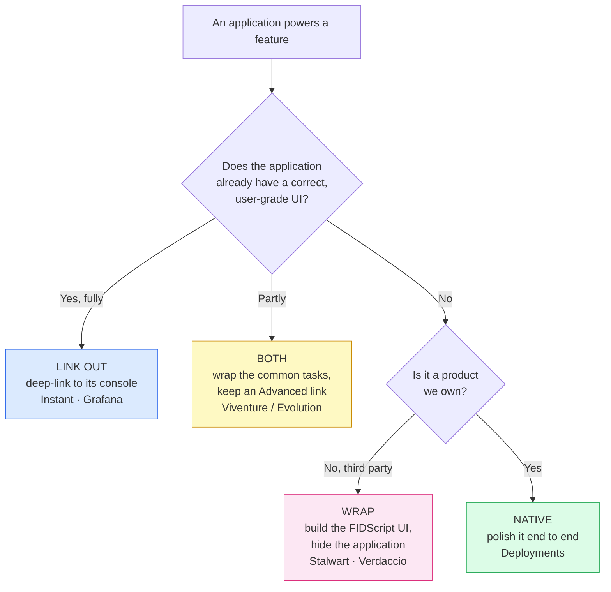

### What is deleted from the platform because an application already does it

| Platform module | Verdict |
|---|---|
| `storage` (project-facing) | **Retire for projects.** Instant owns app files. Platform keeps object storage for its own assets only. |
| `realtime` (project-facing) | **Retire for projects.** Instant is stronger (query-level invalidation, permission-aware). |
| `databases` for app data | **Delegate to Instant.** Keep managed Postgres only as an explicit opt-in capability for deployments that need a raw Postgres connection string. |
| `queues` (NATS) | **Keep, but hide by default.** Surfaces as a capability only when switched on. |
| `functions` | **Keep under Deployments** as a deployment type, not a top-level menu item. |

---

## 4. The top bar (Platform level)

Three items. Nothing else.

```
BEFORE  (confusing on first sign-in)
┌───────────────────────────────────────────────────────────────────────┐
│ Overview   Projects   Applications   API & MCP   Settings             │
└───────────────────────────────────────────────────────────────────────┘
                              │
                              ▼  "Applications" is one-time, so it leaves.
                                 "API & MCP" is a setting, so it leaves.
AFTER
┌───────────────────────────────────────────────────────────────────────┐
│ Overview   Projects   Settings                        [account menu]  │
└───────────────────────────────────────────────────────────────────────┘
```

```
Overview     Projects     Settings                      [account menu]
```

| Item | Purpose |
|---|---|
| **Overview** | The operator's landing page: their projects at a glance, platform health, one line listing installed applications with a **[change]** link. |
| **Projects** | List of projects, with a prominent **New project** button. |
| **Settings** | Platform settings: account, API keys and MCP, organization and team, **Applications**, integrations (GitHub, Cloudflare), audit trail. |

**Moved out of the top bar:**

- **Applications** becomes Settings → Applications, and the Overview line. It is a one-time concern.
- **API & MCP** becomes Settings → API keys & MCP (platform-wide) and, per project, a Project → Connect screen.

---

## 5. The end-to-end journey

### Journey A: the operator (first install, once)

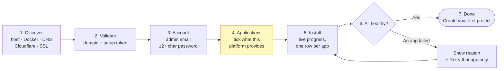

```
/setup  (ONE wizard)
  1. Discover      host, Docker, DNS, Cloudflare, Traefik, SSL
  2. Validate      domain, setup token
  3. Account       admin email + password (12+ characters)
  4. Applications  "Choose what this platform provides"
                   [x] Instant BaaS            Backend as a service
                   [x] Deployments             Build and run apps
                   [x] Email (Stalwart)        Mail on your domain
                   [ ] WhatsApp (Viventure)    WhatsApp Business
                   [ ] Package manager         Private npm / Maven
                   [x] Observability           Metrics, logs, dashboards
                   (App runtime is always on, shown as a status, not a choice)
  5. Install       live progress stream, one row per application
  6. Verify        every application shows Healthy, or what to fix
  7. Done          "Create your first project"   <- a reachable completion screen
```

Rules:

- **Step 4 is the only time the applications are presented as a choice.** After that they live in Settings → Applications.
- Any application can be added later from Settings → Applications. Adding one makes its capability appear as an option in every project's settings.
- If an application fails to install, the wizard shows the reason and a **Retry** button for that application only. It does not block the rest.

### Journey B: the first sign-in (once per person)

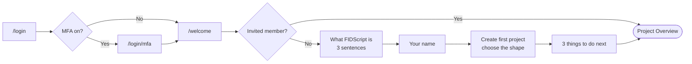

```
/login  ->  (MFA if enabled)  ->  /welcome
  Step 1  What FIDScript is, in three sentences
  Step 2  Your name
  Step 3  Create your first project   <- the shape question (§6)
  Step 4  Three things to do next
  ->  the project's Overview
```

Invited members skip steps 1 and 3 and land directly in the project they were invited to.

### Journey C: every day

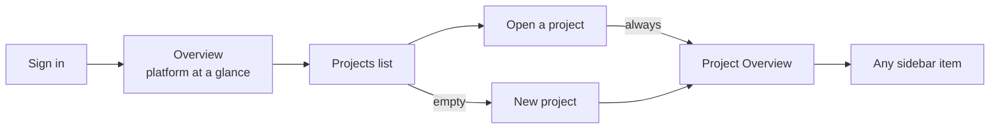

```
Sign in  ->  Overview  ->  Projects  ->  [project]  ->  Overview (always the first screen)
```

`/projects/[id]` **always redirects to the project Overview**. Never to a section.

---

## 6. Creating a project: the shape question

The very first thing asked when creating a project:

```
What will this project do?

( ) Backend as a service     Data, users, files and realtime for an app.     Powered by InstantDB.
( ) Deployments              Build and run your application from git.
( ) Both                     A backend and the app that runs on it.

Name: [______________]
```

Stored on the project in the database, **not** in the browser:

```prisma
enum ProjectShape { BACKEND DEPLOYMENT BOTH }

model Project {
  shape        ProjectShape @default(DEPLOYMENT)
  deploymentOn Boolean      @default(true)
}
```

```
┌──────────────────────── New project ─────────────────────────┐
│  Name  [ Acme Store__________ ]                              │
│                                                              │
│  What will this project do?                                  │
│  ┌─────────────────┐ ┌─────────────────┐ ┌─────────────────┐ │
│  │ ◉ BACKEND       │ │ ○ DEPLOYMENTS   │ │ ○ BOTH          │ │
│  │ Data, users,    │ │ Build and run   │ │ A backend and   │ │
│  │ files, realtime │ │ your app from   │ │ the app that    │ │
│  │ via InstantDB   │ │ git             │ │ runs on it      │ │
│  └─────────────────┘ └─────────────────┘ └─────────────────┘ │
│                                       [ Cancel ] [ Create ]  │
└──────────────────────────────────────────────────────────────┘
```

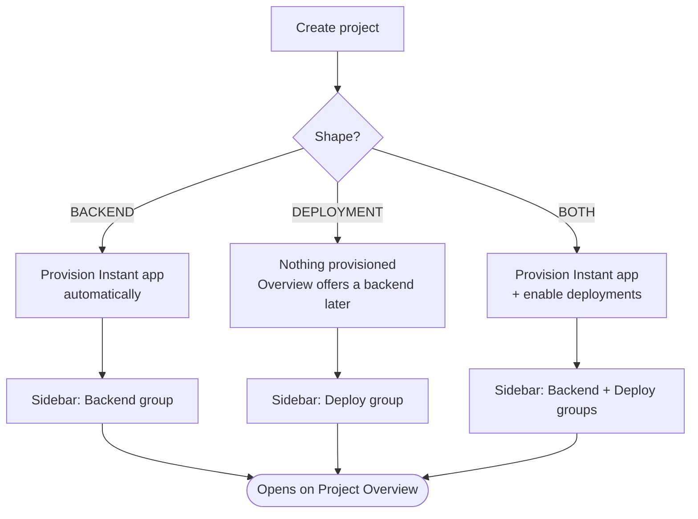

What happens on create:

| Shape | Automatic actions |
|---|---|
| `BACKEND` | An Instant app is **provisioned automatically**; its app ID and config are stored on the project. |
| `DEPLOYMENT` | Nothing provisioned. Overview offers to add a backend later. |
| `BOTH` | Instant app provisioned **and** deployments enabled. |

**The shape is never a dead end.** It is changeable at any time in Project → Settings → "What this project is" (§9).

---

## 7. The project console

### 7.1 The sidebar is derived, not fixed

Two inputs decide the menu:

1. **Shape** and the capability toggles (what the project is allowed to use).
2. **What the project actually has** (what exists).

**The rule:** *the menu shows what the project has; the Overview shows what it could have.*

#### Sidebar by shape

**`BACKEND`**

```
PROJECT        Overview · Members · Activity
BACKEND        Instant console  (opens in a new tab, deep-linked to this project's app)
               Connect          (app ID, SDK snippets, MCP, CLI commands)
CAPABILITIES   Email · WhatsApp · Packages          (only those switched on)
OBSERVE        Monitoring · Logs
               Settings
```

**`DEPLOYMENT`**

```
PROJECT        Overview · Members · Activity
DEPLOY         Deployments · Domains
               Functions                             (if the project has any)
               Databases                             (only if a managed Postgres exists)
CAPABILITIES   Email · WhatsApp · Packages          (only those switched on)
OBSERVE        Monitoring · Logs
               Settings
```

**`BOTH`**

```
PROJECT        Overview · Members · Activity
BACKEND        Instant console · Connect
DEPLOY         Deployments · Domains · Functions
CAPABILITIES   Email · WhatsApp · Packages          (only those switched on)
OBSERVE        Monitoring · Logs
               Settings
```

`Settings` is visible to owners and admins only.

#### The three sidebars side by side

```
 BACKEND                 DEPLOYMENT               BOTH
┌──────────────────┐    ┌──────────────────┐    ┌──────────────────┐
│ PROJECT          │    │ PROJECT          │    │ PROJECT          │
│  Overview        │    │  Overview        │    │  Overview        │
│  Members         │    │  Members         │    │  Members         │
│  Activity        │    │  Activity        │    │  Activity        │
│                  │    │                  │    │                  │
│ BACKEND          │    │ DEPLOY           │    │ BACKEND          │
│  Instant console↗│    │  Deployments     │    │  Instant console↗│
│  Connect         │    │  Domains         │    │  Connect         │
│                  │    │  Functions *     │    │                  │
│ CAPABILITIES *   │    │  Databases *     │    │ CAPABILITIES *   │
│  Email           │    │                  │    │  Email · WhatsApp│
│  WhatsApp        │    │ CAPABILITIES *   │    │  Packages        │
│  Packages        │    │  Email           │    │                  │
│                  │    │  WhatsApp        │    │ OBSERVE          │
│ OBSERVE          │    │  Packages        │    │  Monitoring      │
│  Monitoring      │    │                  │    │  Logs            │
│  Logs            │    │ OBSERVE          │    │                  │
│                  │    │  Monitoring      │    │  Settings        │
│  Settings        │    │  Logs            │    └──────────────────┘
└──────────────────┘    │                  │
                        │  Settings        │  * = appears only if the project has it
                        └──────────────────┘  ↗ = opens the application's own console
```

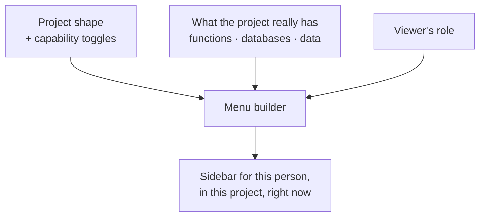

**Removed from the sidebar for every shape:** Services (merged into Deployments), Storage, Realtime, Queues, Scheduler as top-level items. Scheduler and Queues become sections **inside** Deployments and Functions (cron triggers, background jobs) where they are used.

#### Items appear when they exist

| Item | Appears when |
|---|---|
| Domains | A deployment exists, or the person adds a domain |
| Functions | At least one function exists |
| Databases | A managed Postgres was created for this project |
| Email, WhatsApp, Packages | Switched on in Project → Settings → Capabilities |
| Monitoring, Logs | At least one deployment or capability emitting data exists |

Empty projects are not punished with a wall of menu items. The Overview carries the "add" actions instead.

### 7.2 The project Overview (always the first screen)

It must answer **what is this, what does it have, what do I do next.**

```
Acme Store  ·  Backend + Deployments  ·  Active

THE BACKEND       Instant app: acme-store-x7k2 · Healthy
                  [Open console]   [Connect an app]

DEPLOYMENTS       2 running · last deploy 3 hours ago · 1 failed
                  [View deployments]   [New deployment]

CAPABILITIES      Email          Off     [Turn on]
                  WhatsApp       On      3 instances connected
                  Packages       Off     [Turn on]

NEXT              Connect your domain                  [Connect]
```

How the **NEXT** line is chosen (first match wins):

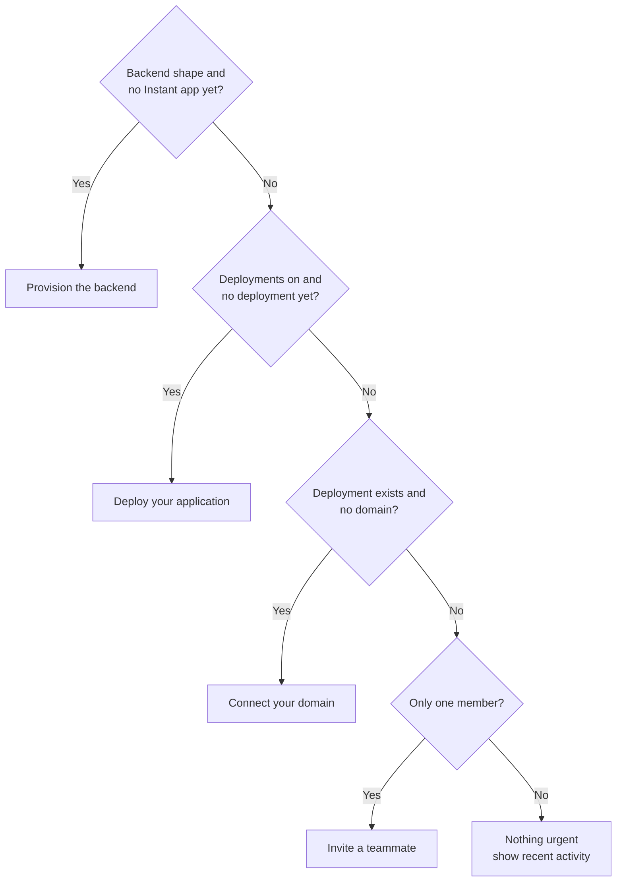

Every number is **real**, from the API. If a number cannot be known, show "Not available", never a placeholder.

---

## 8. Each capability, designed

### 8.1 Backend (Instant)

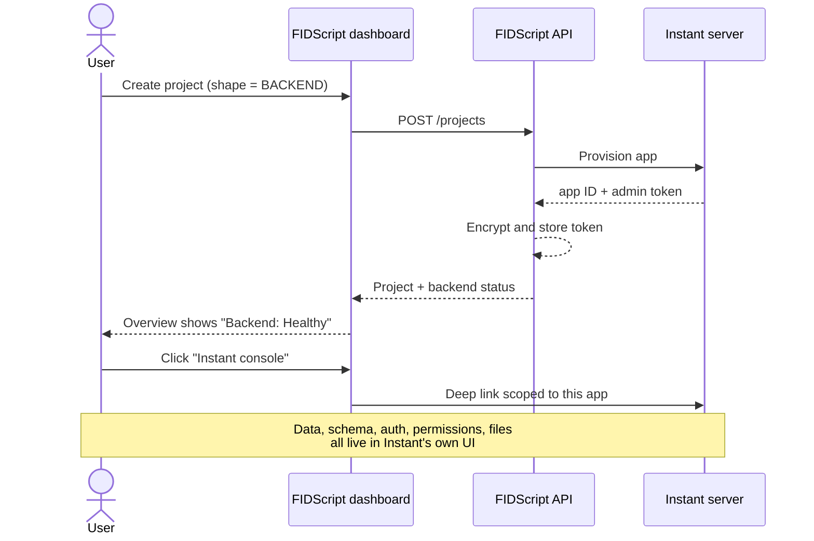

- **Provisioning:** automatic on create for `BACKEND` / `BOTH`; one button for others.
- **Project → Connect:** app ID, admin-token handling (never displayed after creation, rotate only), copy-paste SDK snippets (JS, React, Kotlin), CLI commands, MCP endpoint.
- **"Instant console"** deep-links to `instant.fidscript.com` scoped to the app. FIDScript does **not** build data, schema, auth, permissions or files screens.
- **Status chip** on the Overview: provisioned, healthy, unreachable.

### 8.2 Deployments (Vercel-style)

The headline flow. A person should go from "I have a repo" to "it is live" in under two minutes.

```
New deployment
  1. Source        Connect GitHub -> pick repo -> branch
  2. Detect        Auto-detect framework/buildpack (the existing detect endpoint)
  3. Configure     Name, build command, env vars (secrets masked), region/resources
  4. Deploy        Live build log streams in the page
  5. Live          URL, status, "Add a domain", "Set up auto-deploy on push"
```

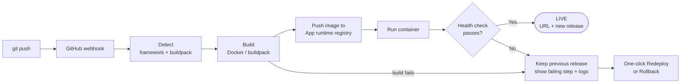

```
New deployment                                      Step 3 of 5
┌───────────────────────────────────────────────────────────────┐
│ ① Source ── ② Detect ── ③ Configure ── ④ Deploy ── ⑤ Live    │
│ ─────────────────────────────────────────────────────────────│
│  Repo      mkid/acme-store            Branch  [ main ▾ ]      │
│  Detected  Next.js 14  ✓                                      │
│  Build     npm run build                                      │
│  Env vars  DATABASE_URL  ••••••••   [ + Add ]                 │
│                                         [ Back ]  [ Deploy ]  │
└───────────────────────────────────────────────────────────────┘
```

Deployment detail page, in tabs:

| Tab | Content |
|---|---|
| **Overview** | Status, URL, current release, repo/branch/commit |
| **Releases** | History with **Rollback** on each |
| **Logs** | Live build log, then runtime logs (Loki) |
| **Metrics** | CPU, memory, network, requests (Prometheus, cAdvisor) |
| **Environment** | Variables and secrets (masked; reveal requires re-auth) |
| **Domains** | Attached domains, DNS records to add, certificate status |
| **Settings** | Branch, build settings, auto-deploy, delete |

Rules:

- **"git push is the whole deploy"** is the promise: the GitHub webhook is set up automatically once a repo is connected.
- Failed builds show the failing step and the last 50 log lines inline, with a one-click **Redeploy**.
- If `deploymentOn` is false, the nav items vanish **and** the New deployment route returns a friendly "Turn on Deployments in Settings" screen, not a 403.

### 8.3 Email (Stalwart wrapped)

Stalwart stays invisible. The FIDScript Email UI is the only face.

```
Email
  Domains      Add domain -> shows exactly the DNS records (MX, SPF, DKIM, DMARC)
               Each record: [copied] and a live status: Verified / Pending / Wrong
               One-click "Fix with Cloudflare" when the Cloudflare connection exists
  Mailboxes    Create, reset password, quota, delete
  Aliases      alias -> destination(s), catch-all
  Sending      SMTP credentials and API key; send a test message
  Deliverability   SPF/DKIM/DMARC pass rate, bounces, complaints, reputation hints
  Inbound      Routes: address -> webhook URL or mailbox; test delivery
  Logs         Message log with status (queued, delivered, deferred, bounced)
```

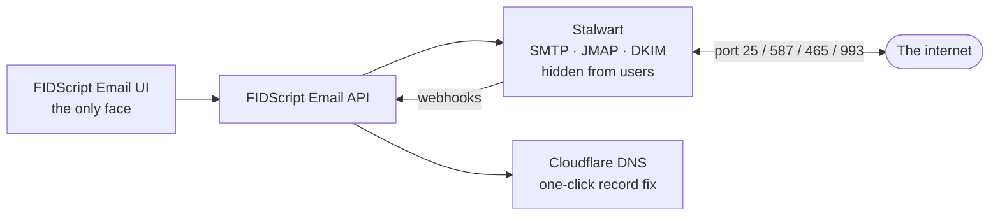

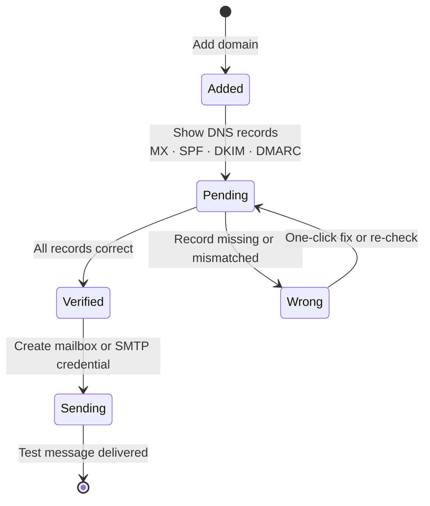

First-run experience for a project with Email on:

1. Add a domain.
2. Publish the shown DNS records (or one-click via Cloudflare).
3. Wait for **Verified** (live status; no refresh needed).
4. Create a mailbox or SMTP credential.
5. Send a test.

The operator-level platform mailbox (`admin/platform-mail`) lives in **Settings → Platform email**, never mixed into a project.

**Stalwart configuration checklist (it is "not yet configured correctly"):** the platform's wizard step must verify and display each of these as a green tick before Email is offered to projects: reverse DNS/PTR, public port 25/465/587/993 reachability, TLS certificate for the mail hostname, DKIM key generated per domain, SPF/DMARC records, outbound relay choice (direct or smarthost), and the Stalwart webhook secret to the API.

### 8.4 WhatsApp (Viventure on Evolution API)

```
WhatsApp
  Instances    List with status: Connected / Awaiting QR / Disconnected
               New instance -> QR code pairing in the page
  Messages     Test send; recent activity
  Webhooks     Event URL, events subscribed, retry status, test delivery
  Tokens       Per-instance API tokens (create, rotate, revoke)
  MCP          Endpoint and tools exposed to agents
  Advanced     [Open Evolution console]   for settings that already have a correct UI there
```

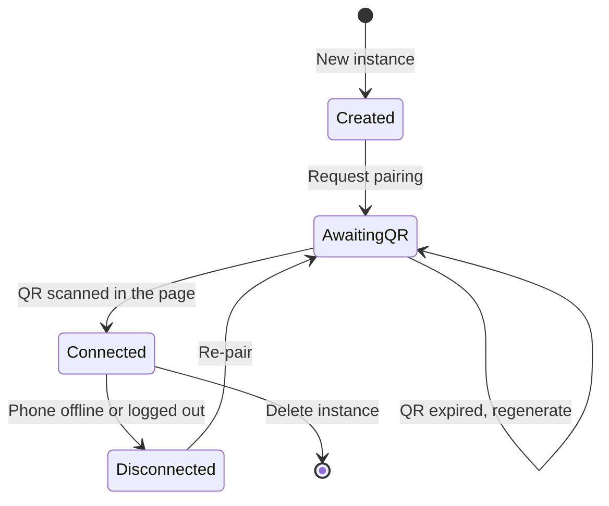

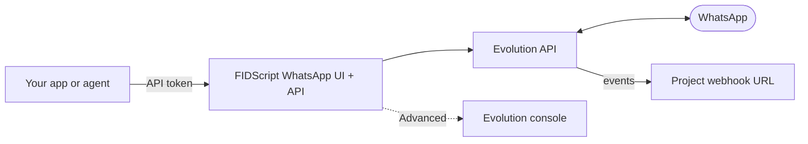

Rules: instances belong to a **project** (not floating at platform level); the Evolution console is a deliberate "Advanced" escape hatch, not the primary UI.

### 8.5 Packages (Verdaccio + Maven wrapped)

```
Packages
  npm        Registry URL, scopes (@acme), published packages with versions and downloads
  Maven      Repository URL, groupIds, published artifacts
  Tokens     Publish/read tokens (scoped, expiring)
  Connect    Copy-paste .npmrc, settings.xml and Gradle snippets
  Publish    "npm publish" walkthrough with the project's registry URL pre-filled
```

Package detail: versions, dist-tags, README, dependencies, deprecate/unpublish. Verdaccio's own UI stays reachable only via Settings → Applications for the operator.

### 8.6 Monitoring and Logs (Prometheus, Loki, Grafana, cAdvisor, Postgres exporter)

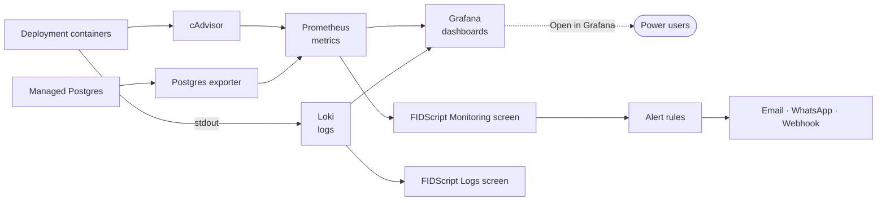

- **Monitoring**: per-project CPU, memory, network, request rate and error rate for each deployment; Postgres health if a managed database exists; alert rules and notification channels (email, WhatsApp, webhook).
- **Logs**: unified stream across deployments and capabilities, filter by source, level and time; live tail; saved queries.
- **Grafana**: **[Open in Grafana]** button providing the pre-provisioned dashboard for this project (filtered by project label). Power users go there; everyone else stays in FIDScript.

---

## 9. Project Settings

```
Settings
  General           Name, slug, description, delete project
  What this project is
      Shape            [ Backend as a service ] [ Deployments ] [ Both ]
      Deployments      [ on / off ]   Turning off hides deployment items and blocks new
                                      deployments. Existing deployments keep running
                                      until you stop them.
      Backend          Instant app: acme-store-x7k2  ·  provisioned  ·  [Open console]
  Capabilities       Email [on/off] · WhatsApp [on/off] · Packages [on/off]
  Members            Roles and invitations
  Environment        Project-level variables and secrets
  Danger zone        Transfer, archive, delete
```

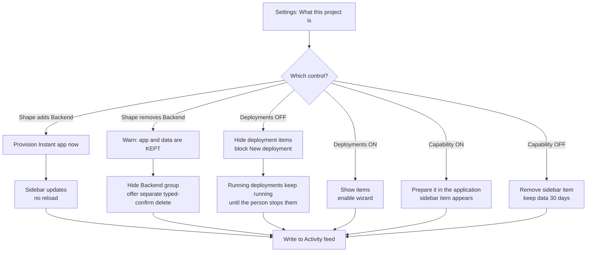

**Behaviour of the toggles (the gate is real, not a label):**

| Action | Result |
|---|---|
| Shape changed to include Backend | Instant app provisioned immediately; sidebar updates without reload |
| Shape changed to remove Backend | Warn: the Instant app and its data are **kept**, not deleted; sidebar hides the Backend group; offer "Delete the Instant app" separately with typed confirmation |
| Deployments turned off | Deployment nav hidden; New deployment blocked; running deployments listed as "stopped on request" only if the person chooses to stop them |
| Capability turned on | Calls the application to prepare it for this project (e.g., create mail domain space, WhatsApp instance quota); sidebar item appears |
| Capability turned off | Data retained for 30 days; item removed from sidebar |

Every toggle change is written to the project's **Activity** feed.

---

## 10. Platform Settings (operator level)

```
Settings
  Account            Profile, password, MFA, sessions
  Organization       Teams, members, invitations
  API keys & MCP     Platform API keys, per-key scopes, MCP server config
  Applications       Every installed application with: status, version, URL,
                     [Open console], [Restart], [Update], [Install more]
  Integrations       GitHub (deployment cloning), Cloudflare (DNS)
  Platform email     The operator's own mailbox and SMTP settings
  Audit              Platform-wide audit trail
```

**Settings → Applications** is the single place the one-time setup is revisited. It lists the same seven items as the wizard, with a health indicator, so the operator can verify the platform at any time without a permanent top-bar slot.

---

## 11. Permissions at a glance

| Role | Can do |
|---|---|
| **Operator** (platform admin) | Everything, including Applications and installation |
| **Project owner** | All project settings, members, delete, toggles |
| **Project admin** | Settings except delete/transfer; manage members |
| **Member** | Use capabilities (deploy, view logs, send mail) but not change settings |
| **Viewer** | Read-only |

Rule: **menu items a role cannot use are hidden, not greyed out.**

---

## 12. Empty states, errors and first-time help

| Situation | What is shown |
|---|---|
| No projects yet | One screen, one button: **Create your first project** |
| New project, nothing set up | Overview with the single highest-value next action |
| Capability application is down | A banner on that capability's screens: "Email is unavailable. The platform is checking Stalwart." Link: Settings → Applications (operator) or "Contact your operator" (member) |
| Application not installed but capability is requested | "This platform does not have WhatsApp installed." Operator sees **[Install]**; others see who to ask |
| Permission denied | Explain which role is needed; never a bare 403 |

---

## 13. Navigation rules (checklist for every new screen)

1. Does it say its **level** in the title or breadcrumb?
2. Does it use the vocabulary in §1?
3. Is it reachable from exactly **one canonical route** (others redirect)?
4. If it is powered by an application with a good UI, does it **link out** instead of rebuilding?
5. Does the menu item appear only when the project **has** the thing?
6. Does an empty state tell the person the next action?
7. Is it listed in `route-inventory.ts`, with the test passing?

---

## 14. Implementation order

| # | Change | Resolves |
|---|---|---|
| 1 | `Project.shape` + `deploymentOn`, migration, API, SDK | Data exists to derive menus from |
| 2 | Project Overview redrawn; `/projects/[id]` redirects to `/overview` | Opens on the wrong screen |
| 3 | Sidebar derived from shape and project contents; delete `use-project-mode.ts` | Fixed 15-item menu, `localStorage` mode |
| 4 | Merge **Services into Deployments**; update redirects and inventory | Three names for one thing |
| 5 | Top bar to three items; Applications moved to Settings and the Overview line | Confusing first impression |
| 6 | Project Settings: shape, deployment switch, capabilities | The on/off control that was asked for |
| 7 | Auto-provision Instant for `BACKEND`/`BOTH`; Connect screen; remove project-facing storage/realtime/app-data screens | Duplicate of Instant |
| 8 | One install wizard (`/setup`) with the Applications step and reachable done screen; delete `/onboarding` | Two wizards, one weak |
| 9 | Email wrapper UI and Stalwart configuration checklist | Email unconfigured |
| 10 | Packages wrapper UI over Verdaccio/Maven | Package manager has no UX |
| 11 | WhatsApp project-scoped UI with Evolution console as Advanced | Viventure integration |
| 12 | Deployment flow polish to Vercel-grade (§8.2) | Core product promise |
| 13 | Monitoring/Logs per project on Prometheus/Loki; Grafana provisioned dashboards | Observability wrapped |
| 14 | Dead code removal | Cleanup |

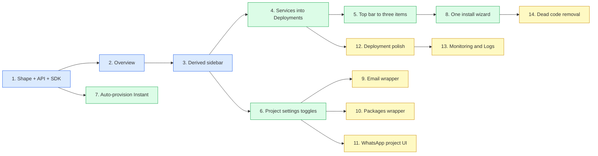

Blue ships as one change. Green is the structural cleanup. Yellow items are independent and can run in parallel.

Steps 1-3 ship as one change. Steps 4-5 ship as one change. Steps 9-13 are independent and can be done in parallel.

---

## 15. Dead code and dead ends to remove

| What | Where |
|---|---|
| `use-project-mode.ts` mode toggle | `apps/dashboard/src/app/(app)/projects/[projectId]/` |
| Unreachable "Back to projects" breadcrumb | `apps/dashboard/src/app/(app)/layout.tsx:67-75` |
| Unreachable `/setup` done step (make it reachable instead) | `apps/dashboard/src/app/(auth)/setup/` |
| Second install wizard | `apps/dashboard/src/app/onboarding/**` |
| Standalone `/databases/[id]` screen | `apps/dashboard/src/app/(app)/databases/[id]/` |
| Unread `fidscript_onboarded` cookie | `apps/dashboard/src/app/onboarding/page.tsx:49` |
| Uncalled `clearError()` (call it or delete it) | `apps/dashboard/src/contexts/auth-provider.tsx` |
| Project-facing Storage, Realtime, Queues, Scheduler top-level screens | Fold into Instant, Deployments and Functions |

---

## 16. Acceptance criteria

A new person with no prior knowledge can, **without help**:

1. Sign in and understand within five seconds that the next step is "Create a project."
2. Choose Backend, Deployments or Both, and see a sidebar that matches that choice.
3. Land on a project Overview that states what the project is, what it has, and the next action.
4. Reach the Instant console in one click from a Backend project.
5. Deploy from a git repository in under two minutes and see logs streaming.
6. Toggle Deployments on or off in Settings and watch the sidebar change immediately.
7. Turn on Email, see exactly which DNS records to add, and watch their status turn green.
8. Never see the Applications page again unless they go looking for it in Settings.

And an operator can, on a fresh server, install the platform through **one** wizard and finish on a screen that says it worked.

---

*Written 2026-11-07. Every "keep" and "delegate" decision follows `docs/CAPABILITY_OVERLAP.md`: use the application where it is already strong, wrap it where it is not, and never build a second weaker copy.*
